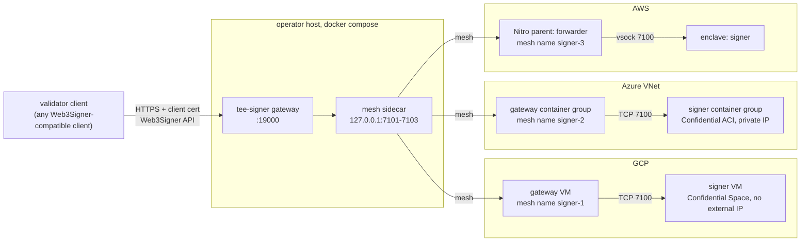

# tee-signer on a private network

An example of how to run [lidofinance/tee-signer](https://github.com/lidofinance/tee-signer)
signers on GCP, Azure and AWS without public signer endpoints, and how to
sign with them from any Web3Signer-compatible validator client through the
repo's Web3Signer gateway.

This is a skeleton to read and adapt, not a turnkey deploy. The signers
themselves are deployed with the tee-signer repo's own tools. This repo adds
the network around them and the gateway on the operator's host.

> tee-signer is an early proof of concept, not audited, and not for mainnet
> funds. The same holds for this example.

## The network is an extra layer

Security does not come from the private network. It comes from two checks the
gateway makes on every connection to a signer:

- mutual TLS 1.3, with a client certificate of the signing role that the
  signer's client CA must accept;
- the signer's attestation (GCP Confidential Space, Azure MAA, AWS Nitro),
  checked against the pins in the gateway config, with the signer's TLS key
  bound to its attested identity.

The network only carries bytes. Whoever runs it can drop or delay traffic. It
cannot read or change what passes, and it cannot pose as a signer. So the same
setup works if you replace the mesh with a VPN or with public endpoints and
an IP allowlist. Only the signer addresses in the gateway config change.

The example uses Tailscale as the mesh. WireGuard, a cloud VPN gateway or any
other network that carries TCP to port 7100 works too.

## Topology



The TLS session runs from the gateway to the signer inside the TEE. The mesh
sidecar, the gateway VM, the gateway group and the parent only forward its
bytes and cannot read or change them.

The gateway sends each sign request to every signer, checks each partial
signature and combines a threshold of them (2 of 3 here) into the validator
signature. Each signer keeps its own slashing protection.

| Part | Where | Trusted? |
|---|---|---|
| validator client | operator host | yes, it holds a client certificate |
| gateway | operator host | holds no key; it can only fail to sign |
| mesh sidecar, gateway VM, gateway group, parent | operator host and clouds | no, they carry bytes |
| signer runner | inside each TEE | yes, checked by attestation |

## Files

| Path | What |
|---|---|
| `compose.yaml` | gateway and mesh sidecar on the operator host |
| `gateway/gateway.example.yml` | gateway config for three signers |
| `mesh/mesh-entry.sh` | sidecar entry: join the mesh, forward local ports to signers by name |
| `gcp/` | gateway VM startup script (mesh, NAT, egress filter) and steps |
| `azure/` | gateway container group template, relay entry, DNS updater and steps |
| `aws/` | script that puts the Nitro parent on the mesh, and steps |

## Prerequisites

- Three signers deployed with tee-signer (main), one per cloud, each holding
  one share of the validator keys, with the private network entry of its
  platform. See the per-cloud folders.
- The gateway binary: build it from tee-signer with `gateway/scripts/build.sh`
  (Go 1.26 and gcc) and copy it to `bin/gateway` here.
- A client certificate of the signing role for the gateway, from the CA the
  signers trust.
- A server certificate for the gateway and a client certificate for each
  validator client. The gateway README, section "Make the certificates", has
  the openssl commands.
- Docker with compose on the operator host.
- A mesh (a Tailscale tailnet here) and an auth key per node, each tagged.

## Steps

### 1. Mesh rules

One tag per node, and one rule: the gateway may reach TCP 7100 of each signer
entry, nothing else. In Tailscale policy syntax:

```json
{
  "tagOwners": {
    "tag:gateway":  ["autogroup:admin"],
    "tag:signer-1": ["autogroup:admin"],
    "tag:signer-2": ["autogroup:admin"],
    "tag:signer-3": ["autogroup:admin"]
  },
  "grants": [
    {
      "src": ["tag:gateway"],
      "dst": ["tag:signer-1", "tag:signer-2", "tag:signer-3"],
      "ip":  ["tcp:7100"]
    }
  ]
}
```

Signer nodes get no access to anything. This filter limits exposure. It is
not what keeps the signers safe.

### 2. Signer entries

Follow the folder of each cloud:

- [gcp/](gcp/README.md): signer VM without external IP, gateway VM with mesh,
  NAT and egress filter.
- [azure/](azure/README.md): signer group with a private IP, gateway group with
  mesh relay and DNS updater.
- [aws/](aws/README.md): the mesh node on the Nitro parent, in front of the
  forwarder.

### 3. Gateway on the operator host

```sh
mkdir -p bin gateway/certs secrets mesh/state
cp /path/to/tee-signer/gateway/bin/gateway bin/
cp gateway/gateway.example.yml gateway/gateway.yml   # fill in the pins
# gateway/certs: server.pem, server-key.pem, client-ca.pem, gateway.pem, gateway-key.pem
install -m 600 /path/to/one-time-key secrets/ts_authkey
docker compose up -d
docker compose logs -f gateway
```

Delete `secrets/ts_authkey` after the first join. The node keeps its state
in `mesh/state`.

### 4. Point the validator client at the gateway

Set the client's Web3Signer (remote signer) URL to the gateway, for example
`https://gateway.example.internal:19000`, with the gateway's server CA and the
client's own certificate. Register each validator key as a remote key at that
URL, or let the client load the list from `/api/v1/eth2/publicKeys`. The
gateway README, sections "Point a validator client at it" and "TLS", has the
details and client examples. A client that offers only TLS 1.2 needs
`tls.min_version: "1.2"` in the gateway config.

The gateway serves `GET /upcheck`, `GET /api/v1/eth2/publicKeys` and
`POST /api/v1/eth2/sign/{pubkey}`. Do not run the same keys through any other
signer at the same time.

## What to check

- The gateway logs `signer attested` for each of `gcp`, `azure` and `aws`, then
  `listening`.
- The key list answers:

  ```sh
  curl --cacert server-ca.pem --cert vc.pem --key vc-key.pem \
    https://127.0.0.1:19000/api/v1/eth2/publicKeys
  ```

- `docker compose exec mesh tailscale status` shows the three signer nodes.
- A request without a client certificate fails the TLS handshake.
- Stop one signer entry: signing goes on with the other two, and the gateway
  logs the failed signer. Start it again: the gateway attests it on the next
  connection.
- If TLS handshakes stall on one path, lower the MTU (`TS_TUN_MTU`).
- With `metrics` set, `teesigner_gateway_signer_connections_up` should be at
  least 1 per signer once requests flow.

## Other network options

The mesh is one way to reach the signers. Any network that carries TCP from
the gateway host to port 7100 of each signer entry works the same way, since
the security comes from mTLS and attestation, not from the network. For each
option: delete the `mesh` service from `compose.yaml`, set each signer
`address` in the gateway config to the address the option gives it, and allow
TCP 7100 to the signer from the gateway's address only. The attestation pins
stay the same in every case.

- **WireGuard or another host VPN.** Run a VPN endpoint in each cloud network
  (a small VM, like the gateway VM here) and on the gateway host. The signers
  keep private addresses; the address is the signer's private IP or name, for
  example `tcp:signer-1.example.internal:7100`. Close to the mesh in effort,
  without a coordination service.
- **Cloud site-to-site VPN.** GCP Cloud VPN, Azure VPN Gateway and AWS
  Site-to-Site VPN connect each cloud network to the operator's network (or
  to each other) over IPsec. No VM to run for the tunnel, but each is a paid
  managed service with its own setup per cloud, and the gateway host must sit
  in the operator's network they reach.
- **Peering or interconnect.** If the gateway host runs in a cloud network,
  VPC peering inside one cloud, or a cross-cloud interconnect between
  clouds, routes to the signers' private addresses directly. Fastest path,
  most setup, and tied to where the gateway host runs.
- **Private endpoints.** AWS PrivateLink, Azure Private Link and GCP Private
  Service Connect expose one service in a network as a private address in
  another. They fit a gateway host that runs in a cloud network of the same
  provider as the signer.
- **Public endpoints.** tee-signer's default entries (GCP external IP with a
  firewall rule, AWS `entry_cidrs`) allow TCP 7100 from the gateway's public
  IP only. Set each `address` to the public endpoint. Least setup; the
  signers' port is visible on the internet, filtered by the allowlist.

## License

Apache-2.0, the same as tee-signer. See [LICENSE](LICENSE).
